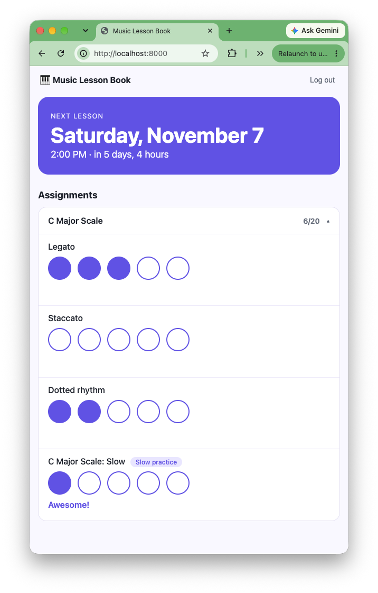

# Music Lesson Book



A practice-tracking web app for music students, inspired by the paper lesson
notebooks where a teacher draws a row of circles and the student fills one in
for every repetition practiced.

## Features

- **Next lesson up front** — the date and time of the upcoming lesson, front and center
- **Pieces with detailed assignments** — each piece expands into specific practice items
  (legato, staccato, dotted rhythm, hands separate, ...), each with its own repetition target
- **Circle check-offs** — click a circle to log one repetition and get instant encouragement,
  with no page reload
- **Progress at a glance** — completed vs. target repetitions per piece
- **Per-student data isolation** — students can only see and check off their own assignments

## Tech stack

Django 6 · SQLite · vanilla JavaScript (fetch API) · pytest

## Data model

```
User ──1:1── Student ──1:N── Piece ──1:N── Assignment ──1:N── Completion
                     └─1:N── Lesson
```

`Assignment.check_off()` records one repetition and refuses to exceed `target_count`
(guarded by a row lock, so double-clicks can't over-count).

## Getting started

Requires Python 3.12+.

```bash
git clone https://github.com/<your-username>/music-lesson-book.git
cd music-lesson-book
python -m venv .venv && source .venv/bin/activate
pip install -r requirements.txt
cp .env.example .env
python manage.py migrate
python manage.py createsuperuser
python manage.py seed_demo
python manage.py runserver
```

- App: http://127.0.0.1:8000/ — log in as `demo_student` / `demo1234` (local demo account only)
- Admin: http://127.0.0.1:8000/admin/ — create students, lessons, pieces, and assignments

## Configuration

Settings come from environment variables (or a local `.env` file):

| Variable | Purpose |
|---|---|
| `DJANGO_DEBUG` | `true` for local development (default `false`) |
| `DJANGO_SECRET_KEY` | Required unless `DJANGO_DEBUG=true` |
| `DJANGO_ALLOWED_HOSTS` | Comma-separated hosts, needed when debug is off |

Generate a secret key:

```bash
python -c "from django.core.management.utils import get_random_secret_key; print(get_random_secret_key())"
```

## Tests

```bash
pytest
```

## Roadmap

- [ ] GitHub Actions CI
- [ ] Docker + PostgreSQL
- [ ] Teacher view for assigning practice inside the app
- [ ] Weekly progress summaries
- [ ] Share progress with parents and teachers
- [ ] REST API (Django REST Framework) for a future mobile app
